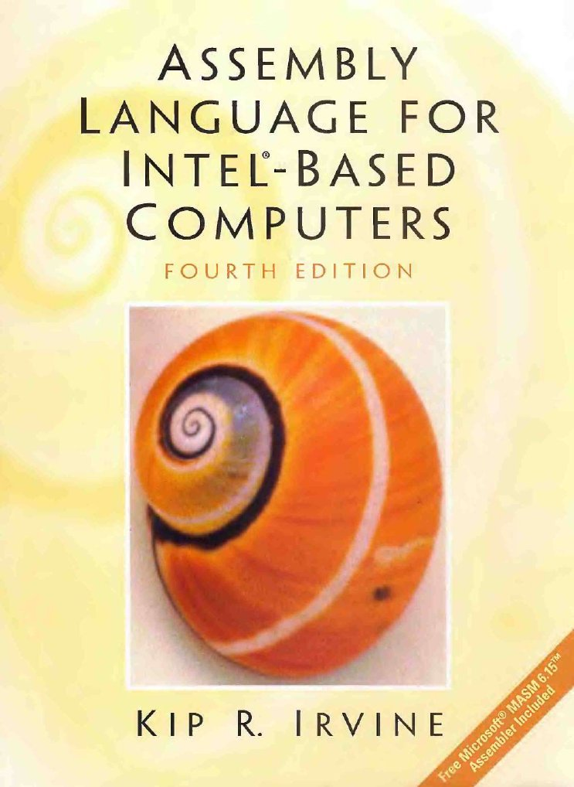

# Course Reference Book

**Kip R. Irvine, _Assembly Language for Intel-Based Computers_, 4th edition.**
Prentice Hall, 2002. ISBN 978-0-13-049146-6.

Most useful for these labs: **chapters 3 to 5** (program structure, the Irvine32 library, data transfer).

## How to get it

The book is **not distributed in this repository** (copyright). Check your university library first.
If you cannot find a copy, send the instructor a short email (your name, study group and the title above) and a copy will be sent to you.
